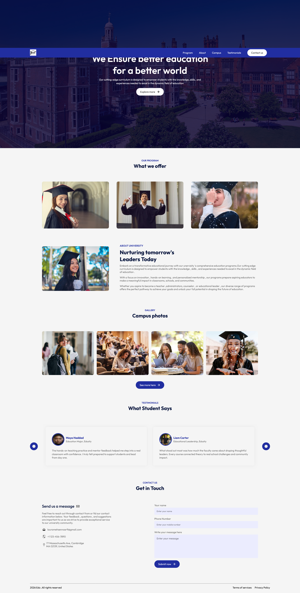

# University Site

A responsive landing page for a university's education programs, built as my first university project.

**Live site:** https://my-first-project-uni.vercel.app/



## About

A modern, single-page website presenting a university focused on education and
teacher training. Visitors can explore the programs, learn about the university,
browse campus photos, read student testimonials, and get in touch through a contact form.

## Sections

- **Hero:** headline, short intro and an "Explore more" call to action
- **Our Program ("What we offer"):** photo cards presenting the programs
- **About University:** story and mission of the university
- **Campus photos:** gallery with a "See more" button
- **Testimonials:** student reviews in a slider
- **Contact us:** contact details and a message form (name, phone, message)
- **Footer:** copyright, Terms of Services and Privacy Policy links

## Features

- Fully responsive design (mobile, tablet, desktop)
- Sticky navigation bar with smooth in-page links
- Testimonials carousel with previous/next controls
- Contact form
- Blue and white theme

## Built with

- [React / HTML, CSS & JavaScript]
- [Vite]
- Deployed on Vercel

## Run locally

```bash
git clone https://github.com/LauraNasr/my-first-project.git
cd my-first-project
npm install
npm run dev
```

## Contact

- LinkedIn: https://www.linkedin.com/in/laura-nasr-154219221
- Email: lauramehsennasr9@gmail.com
